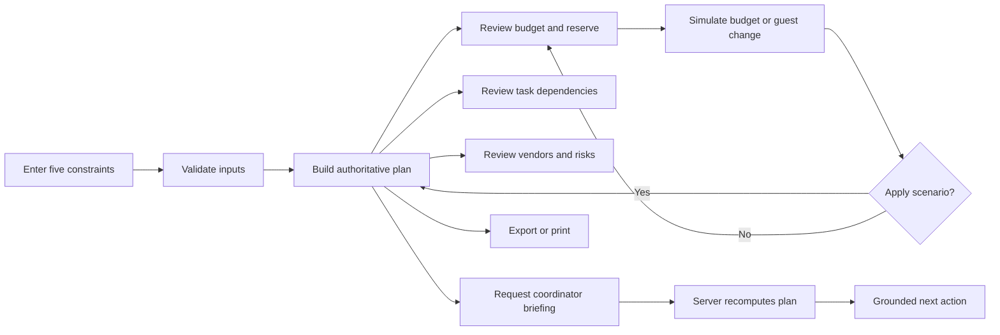

# CuePlan — AI Event Command Center

<div align="center">

**Turn real-world event constraints into an executable, transparent, and adaptable plan.**

[](https://github.com/agbuddy7/cuePlan/actions/workflows/ci.yml)


**Budget intelligence · Dependency-aware execution · Vendor coordination · Risk management · Grounded AI briefings**

</div>

---

## Overview

CuePlan is a production-oriented AI event coordination application designed for community organizers, student teams, volunteer groups, and budget-conscious planners. It transforms five essential constraints—event type, budget, guest count, date, and priority—into a complete operating plan that can be reviewed, simulated, exported, printed, and executed.

The product focuses on the work that happens after an event idea is chosen:

- allocating a fixed budget responsibly;
- protecting contingency funds;
- identifying task dependencies and blockers;
- coordinating vendor cost envelopes;
- evaluating risks before they become emergencies;
- adapting the plan when budget or attendance changes;
- giving organizers a clear next action through an AI coordinator.

CuePlan combines a deterministic planning engine with grounded AI assistance. Calculations remain consistent and auditable, while AI focuses on explanation, prioritization, and coordination.

## Challenge alignment

CuePlan directly addresses **Challenge 5: Celebration and Event Planner**.

| Challenge expectation | CuePlan implementation |
|---|---|
| Go beyond idea generation | Produces an operational budget, task graph, vendor ledger, risk register, and run-of-show inputs |
| Gather user constraints | Uses event type, total budget, guests, event date, and top priority |
| Adapt dynamically | Rebuilds the plan and previews budget/attendance scenarios in real time |
| Manage trade-offs | Calculates per-guest impact, reserve impact, and allocation changes before applying a scenario |
| Track dependencies | Marks tasks as ready or blocked and shows prerequisite task IDs |
| Coordinate vendors | Maintains category envelopes with Estimate and Confirmed provenance states |
| Use transparent AI | Separates deterministic calculations from AI-generated coordination language |
| State assumptions | Includes an assumptions ledger and explicit estimate labels throughout the interface |
| Remain demonstrable | Provides a resilient coordinator mode and complete planning workflow across deployment environments |

---

## Product principles

### 1. Calculations are deterministic

The language model does not calculate the budget. Pure application logic owns:

- category allocations;
- the protected contingency reserve;
- per-guest budget;
- allocation percentages;
- planning health;
- task deadlines;
- task dependencies;
- constraint-derived risks.

This produces repeatable results and keeps the most important planning decisions testable.

### 2. AI coordinates and explains

The AI coordinator receives an authoritative server-recomputed plan. Its role is to translate computed facts into a concise next-action briefing with a relevant trade-off. The coordinator prompt explicitly prevents invented vendors and ungrounded prices.

### 3. Estimates and confirmed costs remain distinct

Every category begins as an **Estimate**. The vendor ledger promotes a cost to **Confirmed** only after an explicit organizer action. This provenance model keeps planning assumptions visible.

### 4. Trade-offs are previewed before they are applied

The What-if Studio creates an isolated scenario. Organizers can inspect the changed per-guest amount, total budget, attendance, and contingency before committing the new constraints.

### 5. The primary workflow remains fast and resilient

Core planning runs on deterministic application logic, producing an immediately usable experience. The coordinator supports live AI briefings when configured and a grounded deterministic briefing mode for resilient demonstrations.

---

## Feature map

### Constraint-driven planning

- Event types for community festivals, birthdays, intimate weddings, fundraisers, and workshops
- Budget validation from ₹10,000 to ₹1,00,00,000
- Guest-count validation from 10 to 5,000 attendees
- Event lead-time validation from 1 to 730 days
- Priority modes:
  - Balanced plan
  - Food quality
  - Guest experience
  - Maximum reach
  - Comfort and accessibility
- Instant plan reconstruction from updated constraints

### Budget intelligence

- Complete budget reconciliation
- Protected 10% contingency reserve
- Working-budget separation
- Category-level allocation percentages
- Indian currency formatting
- Per-guest budget calculation
- Priority-aware reallocation logic
- Visual allocation bars and category color system
- Estimate provenance on unconfirmed costs

The five working categories are:

1. Venue and permits
2. Food and beverage
3. Production
4. Décor and experience
5. People and logistics

### What-if Studio

- Budget adjustment from −30% to +30%
- Guest adjustment from −50 to +100 attendees
- Immediate per-guest impact calculation
- Updated reserve preview
- Updated total-budget preview
- Updated attendance preview
- Explicit **Apply this scenario** action
- Separation between preview state and committed plan state

### Dependency-aware timeline

- Ordered execution sequence
- Ready and blocked task states
- Task ownership
- T-minus deadline representation
- Dependency IDs for prerequisite visibility
- Event brief approval
- Venue and permits
- Vendor quote collection
- Guest-list and accessibility freeze
- Run-of-show and contact tree
- Safety and contingency walkthrough

### Vendor cost ledger

- Category-specific vendor envelopes
- Estimate and Confirmed status labels
- Quote-recording interaction
- Scope, taxes, travel, and cancellation reminders
- Session-level vendor provenance
- Clear distinction between planning allowance and confirmed commercial quote

### Risk register

- Constraint-derived risk creation
- High, medium, and low priority labels
- Per-guest budget pressure detection
- Short lead-time detection
- Crowd-flow planning detection
- Quote-confirmation awareness
- Concrete mitigation attached to every risk
- Plan-health state derived from active risk severity

### AI coordinator

- Server-side OpenAI Responses API integration
- Configurable model through `OPENAI_MODEL`
- Server-only API-key handling
- Authoritative server-side plan reconstruction
- Grounded prompt containing computed facts
- Concise next-action briefing
- Trade-off explanation
- Explicit estimate language
- Deterministic coordinator mode for deployment resilience
- Accessible live-region updates while a briefing is generated

### Plan portability

- JSON plan export
- Print-optimized layout
- Stable plan identifier
- Human-readable dashboard
- Machine-readable allocation, risk, task, and confidence structures

### Responsive interface

- Desktop command-center layout
- Tablet reflow
- Mobile constraint form
- Mobile metrics grid
- Responsive budget and scenario views
- Print stylesheet
- Reduced-motion support

---

## User journey



### Primary demo flow

1. Select **Community fest**.
2. Enter a ₹1,20,000 budget for 120 guests.
3. Choose an event date and **Guest experience** as the priority.
4. Rebuild the plan.
5. Review the protected reserve and working allocations.
6. Reduce the budget by 20% and add 40 guests in the What-if Studio.
7. Review the per-guest impact before applying the scenario.
8. Open Timeline to inspect blockers and dependencies.
9. Open Vendors and record a quote.
10. Open Risks to review mitigation actions.
11. Request the AI coordinator briefing.
12. Export the plan as JSON or print the operating view.

---

## Architecture

```mermaid
flowchart TB
    subgraph Browser[Browser experience]
        UI[Responsive dashboard]
        SIM[What-if simulator]
        LEDGER[Vendor ledger]
        EXPORT[JSON export and print]
    end

    subgraph Static[Vercel static delivery]
        HTML[public/index.html]
        JS[public/app.js]
    end

    subgraph Functions[Vercel Node Functions]
        PLAN[/api/plan]
        COORD[/api/coordinate]
        HEALTH[/api/health]
        ADAPTER[Fetch API adapter]
    end

    subgraph Core[Shared application core]
        VALIDATE[Input validation]
        ENGINE[Deterministic planning engine]
        RISK[Risk and health engine]
        TASKS[Dependency planner]
        AI[Grounded AI coordinator]
    end

    OPENAI[OpenAI Responses API]

    Static --> Browser
    UI --> PLAN
    UI --> COORD
    PLAN --> ADAPTER
    COORD --> ADAPTER
    HEALTH --> ADAPTER
    ADAPTER --> VALIDATE
    VALIDATE --> ENGINE
    ENGINE --> RISK
    ENGINE --> TASKS
    COORD --> AI
    AI --> OPENAI
    SIM --> PLAN
```

### Request lifecycle

#### Plan generation

```text
Browser constraints
  → POST /api/plan
  → body-size enforcement
  → schema and range validation
  → deterministic allocation engine
  → risk and dependency generation
  → authoritative JSON plan
  → dashboard render
```

#### Coordinator briefing

```text
Browser plan
  → POST /api/coordinate
  → rate limiting
  → input validation
  → server-side authoritative plan reconstruction
  → grounded coordinator prompt
  → OpenAI Responses API or deterministic coordinator mode
  → concise next-action briefing
```

### Cross-platform runtime

The shared core uses the standard Fetch API and is deployed through thin platform adapters:

- **Vercel:** generated static assets plus explicit Node Functions
- **Cloudflare-compatible Worker hosting:** default `fetch()` export
- **Local Node preview:** minimal HTTP bridge for development and QA

This structure keeps business logic independent from the hosting provider.

---

## Planning engine

### Budget model

```text
reserve = round(totalBudget × 10%)
usableBudget = totalBudget − reserve
categoryAmount = round(usableBudget × adjustedCategoryWeight)
perGuest = totalBudget ÷ guestCount
```

Base working-budget weights are adjusted by the selected priority. The final category absorbs rounding variance so every generated plan reconciles exactly:

```text
sum(category allocations) + contingency reserve = total budget
```

### Priority behavior

| Priority | Allocation emphasis |
|---|---|
| Balanced | Preserves the baseline distribution |
| Food quality | Increases food allocation and reduces flexible experience categories |
| Guest experience | Increases production and décor allocation |
| Maximum reach | Increases logistics and production allocation |
| Comfort and accessibility | Increases venue and people/logistics allocation |

### Plan health

Plan health is derived from active constraint risks:

- **On track:** healthy lead time and no high-severity constraint signal
- **Watch:** tighter lead time requiring closer execution management
- **At risk:** high-severity budget or scheduling pressure requiring immediate action

### Confidence model

The plan includes separate confidence signals for structure and cost provenance. This allows the interface to represent a well-formed execution plan while maintaining clear visibility into estimate status.

---

## API reference

### `POST /api/plan`

Builds an authoritative event plan.

#### Request

```json
{
  "eventType": "community-fest",
  "budget": 120000,
  "guests": 120,
  "days": 42,
  "priority": "experience"
}
```

#### Response shape

```json
{
  "plan": {
    "id": "CP-COM-120",
    "input": {},
    "reserve": 12000,
    "usable": 108000,
    "allocations": [],
    "perGuest": 1000,
    "risks": [],
    "health": "on-track",
    "tasks": [],
    "confidence": {}
  }
}
```

### `POST /api/coordinate`

Produces a grounded coordinator briefing from a server-recomputed plan.

#### Request

```json
{
  "plan": {
    "input": {
      "eventType": "community-fest",
      "budget": 120000,
      "guests": 120,
      "days": 42,
      "priority": "experience"
    }
  }
}
```

#### Response

```json
{
  "mode": "ai",
  "message": "Approve the event brief first, then lock the venue before comparing vendor quotes...",
  "assumptions": [
    "Costs remain estimates until confirmed by vendors",
    "The deterministic engine owns all calculations"
  ]
}
```

### `GET /api/health`

Returns service readiness information.

```json
{
  "ok": true,
  "service": "cueplan"
}
```

### Error format

Validation responses use a predictable JSON shape:

```json
{
  "errors": ["Choose a supported event type."]
}
```

---

## Security architecture

CuePlan applies security controls at the HTTP boundary and business-logic boundary.

### Input and API controls

- Allowlisted event types and priorities
- Numeric range validation
- Integer validation for guest count and lead time
- 24 KB request-body limit
- Coordinator rate limiting
- Server-side plan reconstruction
- Client-provided totals treated as non-authoritative
- Structured client-safe errors
- Upstream error isolation

### Secret handling

- `OPENAI_API_KEY` is read only from the server runtime
- No secret is embedded in HTML or browser JavaScript
- `.env.example` documents variable names without containing values
- AI requests are made from the server function

### Browser security headers

- Content Security Policy
- `frame-ancestors 'none'`
- `X-Frame-Options: DENY`
- `X-Content-Type-Options: nosniff`
- `Referrer-Policy: no-referrer`
- Restricted Permissions Policy
- Same-origin scripts and network calls
- No external font or image dependency

### Data-minimization posture

The current workflow processes event constraints without requiring personal guest information. Export is initiated explicitly by the organizer and remains under user control.

---

## Accessibility

The interface is designed around keyboard access, clear semantics, non-color status communication, and responsive readability.

Implemented accessibility measures include:

- Skip-to-content link
- Semantic header, main, section, article, aside, and footer landmarks
- Programmatically associated form labels
- Required-field validation
- Visible focus indicators
- Keyboard-operable tabs
- Native range controls
- Text labels alongside all status colors
- `aria-selected` and `aria-controls` tab relationships
- `aria-live` coordinator updates
- `aria-busy` generation state
- Minimum-height interactive controls
- Reduced-motion media query
- Responsive text sizing
- Print-friendly plan output
- High-contrast estimate and confirmation badges

---

## Performance and efficiency

- Zero production runtime dependencies
- Single shared planning module
- No client framework hydration cost
- No external font request
- No third-party image request
- Compact static HTML and JavaScript output
- Instant deterministic planning calculations
- Edge-compatible Fetch API core
- Cacheable JavaScript asset
- No-store policy for personalized plan/API responses
- Build-time generation of Vercel static assets

---

## Testing strategy

The test suite uses Node's built-in test runner and covers business rules, API behavior, security controls, and the Vercel adapter.

### Current automated coverage map

| Area | Test evidence |
|---|---|
| Budget reconciliation | Allocations plus reserve equal the exact input budget |
| Contingency | 10% reserve is protected |
| Constraint pressure | Infeasible per-guest budget produces an active risk |
| Validation | Invalid and nonsensical inputs are rejected |
| Priority modes | Every priority preserves total reconciliation |
| Coordinator resilience | Grounded deterministic briefing remains available |
| Server authority | Tampered client totals are ignored and recomputed |
| HTTP security | CSP, MIME, frame, and permissions headers are asserted |
| Static application | Vercel build sources contain the complete experience |
| Health function | Vercel function reaches the shared application core |
| API adapter | Vercel preserves validation status and response shape |

Run all quality gates:

```bash
npm test
npm run build
npm run validate
```

GitHub Actions runs the same verification flow on pushes and pull requests to `main`.

---

## Project structure

```text
cuePlan/
├── .github/
│   └── workflows/
│       └── ci.yml                 # Automated quality gates
├── .openai/
│   └── hosting.json               # Worker-hosting manifest
├── api/
│   ├── coordinate.js              # Vercel coordinator function
│   ├── health.js                  # Vercel health function
│   └── plan.js                    # Vercel planning function
├── lib/
│   └── vercel-adapter.js          # Node-to-Fetch API bridge
├── scripts/
│   ├── build.mjs                  # Worker + Vercel static build
│   ├── preview.mjs                # Local HTTP preview
│   └── validate-artifact.mjs      # Deployment artifact validation
├── tests/
│   ├── engine.test.mjs            # Engine, API, and security tests
│   └── vercel-adapter.test.mjs    # Vercel integration tests
├── worker/
│   └── index.js                   # UI, planning engine, routes, AI integration
├── .env.example                   # Runtime configuration contract
├── SECURITY.md                    # Security policy and controls
├── package.json                   # Quality and build commands
├── vercel.json                    # Vercel production configuration
└── README.md                      # Product and engineering documentation
```

The generated `public/` directory contains Vercel's deployable static assets. The generated `dist/` directory contains the Worker deployment artifact.

---

## Local development

### Requirements

- Node.js 22+
- npm

### Setup

```bash
git clone https://github.com/agbuddy7/cuePlan.git
cd cuePlan
npm test
npm run build
node scripts/preview.mjs
```

Open:

```text
http://127.0.0.1:4173
```

### Environment variables

```bash
OPENAI_API_KEY=your_server_side_key
OPENAI_MODEL=gpt-5-mini
```

| Variable | Purpose |
|---|---|
| `OPENAI_API_KEY` | Enables live grounded AI coordinator briefings |
| `OPENAI_MODEL` | Selects the coordinator model; defaults to `gpt-5-mini` |

---

## Vercel deployment

CuePlan is configured for direct GitHub import.

### Dashboard deployment

1. Open Vercel and select **Add New → Project**.
2. Import `agbuddy7/cuePlan`.
3. Use **Other** as the framework preset.
4. Keep the repository root as the Root Directory.
5. Allow `vercel.json` to provide:
   - Build Command: `npm run build`
   - Output Directory: `public`
   - Function configuration for `api/*.js`
6. Add `OPENAI_API_KEY` as a server-side environment variable.
7. Optionally add `OPENAI_MODEL=gpt-5-mini`.
8. Deploy.

### CLI deployment

```bash
npx vercel
npx vercel --prod
```

### Production verification

After deployment, verify:

```text
GET  /api/health
POST /api/plan
POST /api/coordinate
GET  /
GET  /app.js
```

The landing page should render the default community-fest plan, and `/api/health` should return `{ "ok": true, "service": "cueplan" }`.

---

## CI/CD

The repository includes a least-privilege GitHub Actions workflow.


Recommended branch protection:

- Require the **Quality gates** workflow
- Require pull-request review
- Prevent force pushes to `main`
- Enable dependency and secret scanning
- Connect Vercel production deployment to `main`
- Use preview deployments for pull requests

---

## Production extension map

The architecture provides clear integration seams for a larger multi-user event operations platform.

### Persistent planning workspace

- User-owned event records
- Versioned plans and scenario history
- Confirmed vendor quote persistence
- Task completion state
- Audit history for estimate-to-confirmed transitions

### Identity and team collaboration

- Organizer authentication
- Role-based access for owner, finance, logistics, guest lead, and producer
- Event-level team invitations
- Approval workflows
- Activity feed and comments

### Vendor operations

- Vendor profiles
- Quote comparison
- Contract and invoice attachments
- Payment milestone tracking
- Cancellation-policy capture
- Vendor communication history

### Guest operations

- RSVP collection
- Accessibility and dietary aggregation
- Capacity management
- Check-in workflow
- Privacy-aware guest exports

### Scheduling and notifications

- Calendar synchronization
- Deadline reminders
- Dependency-unblocked alerts
- Budget-threshold notifications
- Vendor confirmation reminders
- Event-day run-of-show notifications

### Analytics and observability

- Budget variance analytics
- Estimate-versus-confirmed reporting
- Task completion velocity
- Coordinator request tracing
- Structured logs and error monitoring
- Performance and availability dashboards

These extension points align with the existing authoritative-plan API, task identifiers, allocation provenance, and provider-neutral core.

---

## Evaluation rubric map

### Code quality

- Pure deterministic planning functions
- Provider-neutral Fetch API core
- Thin deployment adapters
- Centralized configuration
- Structured response shapes
- Zero runtime dependencies
- Clear project separation
- Automated CI quality gates

### Security

- Server-only API secret
- Input validation and allowlists
- Request-size enforcement
- Rate limiting
- Server-side authoritative recomputation
- Safe error responses
- CSP and browser security headers
- Explicit data-minimization model

### Efficiency

- Static HTML and JavaScript delivery
- Instant deterministic client experience
- Small serverless functions
- No framework runtime
- No external fonts or images
- Cacheable application asset
- Shared core across deployment targets

### Testing

- Budget invariants
- Constraint risk detection
- Validation behavior
- Priority-shift reconciliation
- Coordinator resilience
- Tamper resistance
- Security headers
- Vercel static and API integration
- Automated GitHub Actions execution

### Accessibility

- Semantic landmarks
- Keyboard-first interactions
- Visible focus
- Native form controls
- Live coordinator status
- Non-color labels
- Reduced-motion support
- Responsive and printable layout

### Problem-statement alignment

- Constraint-first onboarding
- Executable budget
- Dynamic trade-off simulation
- Dependency-aware timeline
- Vendor coordination
- Risk mitigations
- Transparent estimates
- Grounded AI coordination

---

## Submission assets

For a strong demonstration, present CuePlan in this order:

1. Explain the target persona and execution problem.
2. Build a plan from five constraints.
3. Show the exact budget reconciliation and protected reserve.
4. Stress-test the plan in the What-if Studio.
5. Show timeline dependencies and blockers.
6. Record a vendor quote to demonstrate cost provenance.
7. Review the risk register and mitigations.
8. Request an AI coordinator briefing.
9. Export or print the resulting plan.
10. Show the automated test and CI evidence.

---

## Repository

- Source: [github.com/agbuddy7/cuePlan](https://github.com/agbuddy7/cuePlan)
- Primary branch: `main`
- Deployment target: Vercel
- Runtime: Node.js 22 / standard Fetch API

---

<div align="center">

**CuePlan turns event planning from a collection of ideas into a coordinated execution system.**

</div>
