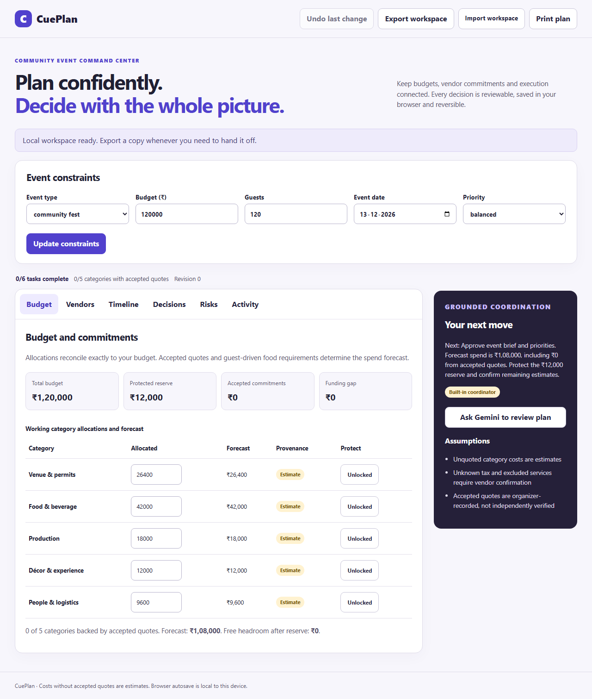
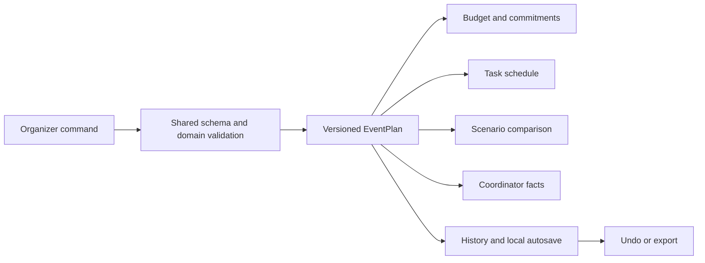

# CuePlan — Event Decision Workspace

[](https://github.com/agbuddy7/cuePlan/actions/workflows/ci.yml)

**A connected workspace for community organizers managing budgets, vendor commitments, task dependencies, and last-minute decisions.**

CuePlan turns five event constraints into a working budget and execution plan. Organizers can record actual vendor quotes, compare effective costs, accept commitments, adjust category allocations, simulate changes, track dependencies, and undo decisions. Google Gemini reviews a compact set of computed facts and provides a grounded next-action briefing.

Built for **Challenge 5: Celebration and Event Planner**. The primary persona is a volunteer or student organizer coordinating a community celebration with limited funds and multiple responsibilities.



[Mobile workspace preview](docs/screenshots/workspace-mobile.png) · [v2 release evidence](docs/RELEASE-v2.md)

## Start here

```bash
git clone https://github.com/agbuddy7/cuePlan.git
cd cuePlan
npm ci
npm run dev
```

The development server serves both the application and `/api` functions. No provider credential is required for deterministic planning and the built-in coordinator. Configure `GEMINI_API_KEY` in the server environment to enable live Gemini briefings.

```bash
npm run verify       # format, lint, types, coverage and production build
npm run test:e2e     # desktop/mobile browser and accessibility journeys
```

## Product walkthrough

1. Set the occasion, budget, attendance, date and priority.
2. Review allocations, protected contingency, forecast spend and funding gap.
3. Record a vendor quote with its pricing basis, minimum billing, tax treatment, deposit and terms.
4. Compare quotes and explicitly accept one. Accepted quotes drive committed spend.
5. Lock essential categories or adjust unlocked allocations. Redistribution preserves the budget.
6. Preview a budget or guest-count change in **Decisions** before applying it.
7. Complete a prerequisite task to unlock dependent work. Add an owner or delay to see downstream impact.
8. Review a Gemini briefing, inspect activity history, undo a change, export a workspace or print an operating summary.

## Implemented feature map

| Workspace         | What an organizer can do                                                                     | Source                              |
| ----------------- | -------------------------------------------------------------------------------------------- | ----------------------------------- |
| Constraints       | Choose one of five occasions, budget, guests, date and priority                              | `ConstraintsForm.tsx`, `schema.ts`  |
| Budget            | See allocations, reserve, committed spend, forecast and funding gap                          | `BudgetPanel.tsx`, `budget.ts`      |
| Redistribution    | Change an unlocked allocation while preserving the total                                     | `redistribute()`                    |
| Protection        | Lock categories; accepted quote allocations remain protected                                 | `execute()`, `redistribute()`       |
| Vendor quotes     | Store up to three comparable quotes per category                                             | `QuoteForm.tsx`, `VendorsPanel.tsx` |
| Quote calculation | Compute fixed/per-guest prices, minimum billing, extra tax and deposits                      | `quoteCost()`                       |
| Quote acceptance  | Accept one quote per category and update committed spend                                     | `execute()`                         |
| Vendor flags      | Identify tax uncertainty, missing cancellation terms, minimum billing and allocation overrun | `VendorsPanel.tsx`                  |
| Forecasting       | Scale estimated food demand with attendance and retain accepted commercial terms             | `budgetFacts()`                     |
| Decisions         | Review before/after allocations, reserve, funding gap and task warnings                      | `ScenarioPanel.tsx`                 |
| Alternatives      | Review feasible budget increases, guest reductions and bounded flexible-category trims       | `tradeoffs()`                       |
| Execution         | Complete ready tasks and unlock dependents                                                   | `workflow.ts`, `TimelinePanel.tsx`  |
| Delays            | Edit owners and propagate scheduling delay through dependencies                              | `schedule()`                        |
| State             | Preserve quotes and progress during constraint changes                                       | `execute()`                         |
| History           | Record actions with revisions; undo up to 20 snapshots                                       | `workspace.ts`                      |
| Persistence       | Validate and autosave the complete workspace in local browser storage                        | `useWorkspace.ts`                   |
| Portability       | Export/import a validated versioned JSON workspace                                           | `importWorkspace()`                 |
| Print             | Print a dedicated budget, execution and accepted-vendor summary                              | `PrintSummary.tsx`                  |
| Coordination      | Receive a fact-grounded Gemini or deterministic next-action briefing                         | `gemini.ts`, `briefing.ts`          |

## One plan, consistent decisions



The plan is the only authoritative browser state. Budget totals, risks, readiness and schedule status are derived from it. Components dispatch typed commands; they do not silently edit separate financial or task records.

## Money and provenance

- Money is stored in integer rupees.
- The initial reserve is rounded from 10% of the budget.
- Occasion weights and priorities determine the working allocations.
- Largest-remainder apportionment assigns every rupee deterministically.
- Allocations plus reserve always equal the declared budget.
- Quote costs are derived from recorded vendor terms; accepted quotes contribute to committed spend.
- Unquoted food demand uses an explicit estimated rate times guest count.
- Unknown tax remains visibly unconfirmed; excluded services require organizer review.
- A funding gap is displayed rather than silently increasing the budget.
- Accepted quote means accepted by the organizer, not independently verified by CuePlan.

```text
working allocation = budget − reserve
forecast = accepted quote costs + remaining estimated category costs
funding gap = max(0, forecast + reserve − budget)
```

## Decisions with protected commitments

The decision studio evaluates changes against the current plan. It retains accepted quotes, task progress and category locks. A constraint change that cannot fund protected category allocations is rejected with an actionable error. Feasible alternatives show the amount of funding pressure they remove. Flexible trims exclude locked, accepted and food categories and cap cuts at 40% of each eligible category.

Applying a decision records a revision and previous snapshot. Undo restores that snapshot while retaining a monotonically increasing revision number and activity record.

## Dependency-aware execution

The initial workflow covers brief approval, venue/access, quote procurement, guest needs, run-of-show and a safety walkthrough. Templates scale their initial lead times to the event runway and occasion. Graph validation rejects duplicate identifiers, missing references, cycles and completion sets missing prerequisites.

Task status is derived as `blocked`, `ready`, or `completed`. Delays propagate along the critical upstream path; parallel prerequisite delays use their maximum rather than summing unrelated branches. Overdue and post-event work is labeled explicitly.

## Google Gemini integration

Gemini is used for coordination language. The server validates the submitted plan, recomputes budget and schedule facts, and sends that compact fact set to the Google Generative Language API. Full vendor notes, task-owner names and workspace history are not included in the fact prompt.

The adapter uses a six-second request deadline, constrained output length, server-only secrets and schema validation of provider output. Missing credentials, empty output, provider errors and transport failures return a deterministic briefing from the same current plan facts. The UI identifies which mode answered and cancels stale requests after plan changes.

| Variable         | Purpose                                                                 |
| ---------------- | ----------------------------------------------------------------------- |
| `GEMINI_API_KEY` | Server-side Google AI credential                                        |
| `GEMINI_MODEL`   | Model enabled for your Google project; overrides the repository default |

Set variables in Vercel project settings. Local development reads exported process environment variables. `.env.example` lists names and placeholders; never commit a populated environment file.

## Engineering architecture

CuePlan uses a modular monolith with a typed domain, immutable commands, a browser persistence adapter, a provider adapter and thin Vercel handlers. The domain has no React, network, filesystem or deployment dependency.

```text
src/
  domain/        schema, integer money, budget, plan commands, workflow, scenarios, dates
  application/   computed coordinator facts and deterministic briefing
  state/         workspace history, validation, persistence and React adapter
  server/        HTTP guards, rate limiting and Gemini transport
  ui/            focused React forms, panels and printable summary
api/             Vercel plan, coordinate and health entry points
tests/           invariant, command, storage, provider and HTTP regression tests
e2e/             complete browser journeys and axe checks
docs/            architecture, API, operations, testing and accessibility evidence
```

### Quality gates

TypeScript enables `strict`, `noUncheckedIndexedAccess`, unused-symbol checks and switch fallthrough checks. ESLint runs type-aware rules, React Hooks rules and JSX accessibility rules. Prettier provides a consistent reviewable style. The committed lockfile makes CI installation reproducible.

The coverage scope is the domain, command history, coordinator application and server—not the entire React UI. UI flows have a separate Playwright suite. Reports are generated from actual execution rather than maintained as hard-coded badge percentages.

## Security and privacy

- Shared Zod schemas validate plan structures at import and API boundaries.
- Graph and budget invariants supplement structural validation.
- HTTP method, JSON media type, origin and 64 KB body checks protect API entry points.
- Coordinator requests have bounded per-instance admission control and a provider timeout.
- Credentials remain server-side; the client receives only a validated briefing.
- React renders user and provider text as text, without HTML injection.
- External scripts, fonts and images are unnecessary; the production CSP excludes inline scripts and inline styles.
- Vercel sends frame, MIME, referrer, permissions and transport security headers.
- Local persistence requires no account and sends no workspace to a database.
- Gemini review sends a compact derived fact set when explicitly requested.

See [SECURITY.md](SECURITY.md) for the trust model and reporting guidance.

## Deployment on Vercel

Import this repository, select **Other**, and keep the repository root. `vercel.json` declares the build and `dist` output. The `api/*.ts` files are native Node functions. No catch-all rewrite is required.

```bash
npm ci
npm run verify
npx vercel --prod
```

After changing Google credentials or model configuration, redeploy. Verify `/api/health`, initial rendering, an accepted quote, a guest-count scenario, task completion and workspace restoration. The operational runbook includes rollback and troubleshooting.

## Documentation map

| Document                               | Contents                                                          |
| -------------------------------------- | ----------------------------------------------------------------- |
| [Architecture](docs/ARCHITECTURE.md)   | Boundaries, data model, invariants, decisions and extension seams |
| [API](docs/API.md)                     | Request contracts, responses, errors and trust model              |
| [Operations](docs/OPERATIONS.md)       | Local setup, Vercel release, rollback and diagnostics             |
| [Testing](docs/TESTING.md)             | Commands, coverage scope, invariant matrix and browser journeys   |
| [Accessibility](docs/ACCESSIBILITY.md) | Keyboard, semantic, responsive and automated validation approach  |
| [Contributing](CONTRIBUTING.md)        | Verification and change conventions                               |
| [Security](SECURITY.md)                | Secrets, storage boundaries and HTTP controls                     |

## Challenge evaluation map

| Criterion     | Implementation evidence                                                                                                 |
| ------------- | ----------------------------------------------------------------------------------------------------------------------- |
| Code quality  | Strict TypeScript, shared contracts, immutable commands, focused React components and enforced CI                       |
| Security      | Validation, invariant checks, quota controls, cancellation, server secrets and strict CSP                               |
| Efficiency    | Local deterministic calculations, bounded history, compact AI facts and static asset delivery                           |
| Testing       | Budget matrices, workflow graph validation, provider failure tests, HTTP contracts and full browser journeys            |
| Accessibility | Native controls, semantic tables, keyboard tabs, visible focus, live status, reduced motion and axe checks              |
| Alignment     | Execution planning, real vendor commitments, dependency tracking, constraint-aware trade-offs and transparent estimates |

## Deliberate system boundaries

This release is a local-first single-organizer workspace. Autosave and change history are stored on the current browser; JSON export provides portable handoff. It does not claim a multi-user database, cloud collaboration, immutable server audit log, vendor verification or automatic payments. Architecture proposals for those capabilities are labeled in the design reference.

The previous buildless Worker implementation is superseded by the Vercel-focused TypeScript/React application in this release. Legacy deployment scripts and generated-source patterns have been removed rather than retained as competing runtime paths.
