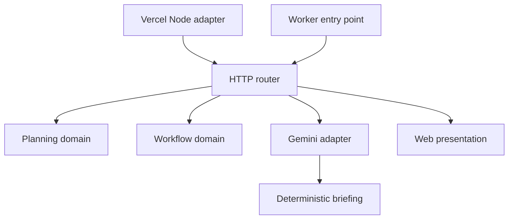

# Architecture and design decisions

CuePlan is a modular monolith deployed as stateless HTTP functions with static browser assets. One authoritative domain model is reused by Vercel and Worker entry points. This topology keeps a small event-planning application simple to operate while making its boundaries explicit and testable.

## Responsibility map

| Boundary | Source | Contract |
|---|---|---|
| Domain planning | `src/domain/planning.js` | Valid constraints → reconciled plan |
| Domain workflow | `src/domain/workflow.js` | Task DAG + completed IDs → valid task states |
| Application briefing | `src/application/briefing.js` | Computed plan → deterministic briefing |
| AI adapter | `src/infrastructure/gemini.js` | Computed plan + credentials + transport → briefing |
| Admission control | `src/infrastructure/rate-limit.js` | Request identity + injected clock → admission decision |
| HTTP boundary | `src/http/router.js` | Fetch request → validated response |
| HTTP policy | `src/http/responses.js` | Response headers and bounded JSON parsing |
| Web presentation | `src/web/page.js`, `src/web/client.js` | Responsive interface and user actions |
| Hosting adapter | `lib/vercel-adapter.js`, `api/` | Node request → Fetch request |
| Compatibility entry | `worker/index.js` | Stable public exports and Worker handler |

## Dependency direction

Domain modules import no network client, hosting SDK, database, browser API, or HTTP router. Infrastructure receives transport dependencies so provider behavior can be tested without credits or network calls.

## ADR 001: modular monolith

Decision: use modules with explicit responsibilities rather than separately deployed services. The current workload shares one domain, one release cadence and small request payloads. Service extraction would introduce network consistency, deployment and observability work without helping the primary workflow. Future persistent collaboration can be added behind an application repository boundary.

## ADR 002: authoritative recomputation

Every coordinator request rebuilds the plan from validated constraints. Client-supplied allocation amounts, reserve values, risks and task arrays are never authoritative. This eliminates a class of inconsistent calculations and prompt-context tampering. The stateless task endpoint likewise rebuilds the graph and validates the requested completion set against prerequisites.

## ADR 003: normalized budget weights

The working budget is the total minus the protected reserve. Category weights, including priority shifts, are normalized by their sum before allocation. Amounts use integer rupees. Intermediate categories round to ₹100 and the last category receives the reconciliation remainder. Tests exercise low, large and non-round budgets across every priority. The balancing category absorbs rounding variance, not an unallocated percentage of the budget.

## ADR 004: dependency graph state machine

Tasks transition through `blocked → ready → completed`. Readiness is derived from the graph, never manually asserted by a client. The graph validator rejects duplicate IDs, unknown references, cycles and completion sets missing prerequisites. A completion operation returns a new graph and preserves the input. T-minus deadlines are ordered so a prerequisite is scheduled no later than its dependent; compressed event windows may share deadlines.

## ADR 005: bounded AI integration

Gemini is a server-side adapter using the Google Generative Language API. The model remains configurable through `GEMINI_MODEL`; the existing workspace model setting is preserved. The adapter supplies only computed context, requests a short response and uses a six-second cancellation deadline within Vercel's ten-second function budget. Empty responses, upstream errors and transport failures return the deterministic briefing. The transport can be injected in tests.

## ADR 006: bounded admission control

The coordinator limiter isolates client identities using hosting forwarding headers, removes expired entries, and bounds its identity map. Its current semantics are per-process, which fits the stateless demo topology. A globally enforced quota would replace this adapter with an atomic shared-store implementation. Forwarded identities must be trusted only behind hosting ingress that controls those headers.

## ADR 007: static delivery with shared application core

The build produces Vercel assets in `public/` and a separate Worker artifact in `dist/`. The Worker artifact contains its module dependencies and ESM package metadata. The artifact validator imports the built entry point from its actual filesystem location. Vercel static responses receive explicit platform headers because static delivery bypasses the Node adapter.

## State and consistency

The current planning API is pure and stateless. Browser state holds the active plan and completed tasks. A rebuild begins a fresh execution plan. Export captures the current plan for portable handoff. Vendor confirmation currently records an in-session provenance state. The application does not currently implement durable multi-user records, payment execution, vendor messaging or authentication.

## Proposed durable workspace design

This is a design proposal, not a shipped service. Introduce an event aggregate with a monotonically increasing version, optimistic concurrency (`If-Match`), and per-event authorization. Store task completions and vendor quote provenance in transactions. Give each command an idempotency key scoped to the actor and event. Use a transactional outbox for reminders and integration messages, with a unique delivery key and bounded retry policy. Those mechanisms become useful when external writes and concurrent editors are introduced; they are unnecessary for the current pure plan calculation.

## Proposed observability design

Add structured request logs containing a generated request ID, route, latency, status, coordinator mode and provider duration; exclude credentials and full prompts. Track fallback rate, timeout rate, invalid request rate and plan latency. Introduce trace propagation before splitting services. Availability and performance targets should be based on measured deployments rather than asserted benchmark numbers.
