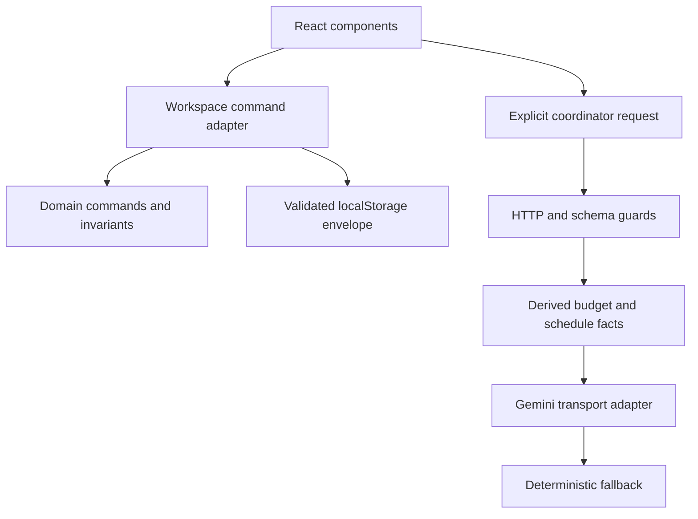

# Architecture reference and decisions

## Context

The core problem is keeping event commitments, estimated costs and execution state consistent when constraints change. The application is one typed codebase with a pure domain and replaceable adapters. Vercel delivers static assets and three HTTP functions. Browser operations are local and synchronous; only a requested Gemini review requires an external service.

## Boundaries and dependencies

| Boundary    | Responsibility                                  | Allowed dependencies         |
| ----------- | ----------------------------------------------- | ---------------------------- |
| Domain      | Schemas, arithmetic, commands, graph, scenarios | Zod and other domain modules |
| Application | Compute briefing facts and fallback language    | Domain                       |
| State       | History, import validation, local persistence   | Domain                       |
| Server      | Validate requests, admit calls, invoke Gemini   | Domain and application       |
| UI          | Render facts and dispatch commands              | Domain, state, application   |
| Hosting     | Adapt Vercel requests                           | Server                       |

The domain never imports React, Vercel, localStorage or a network client. `coordinate()` receives its transport as an optional dependency, allowing provider behavior to be tested without a key.

## Data model

`EventPlan` has version, identifier, revision, constraints, integer allocations, reserve, explicit estimated food rate, locked categories, vendor quotes and tasks. `Workspace` adds up to 20 previous plan snapshots and 100 activity entries. It is the exported/imported storage contract.

Quotes hold original commercial terms: fixed/per-guest basis, amount, minimum billing, tax inclusion, extra tax percentage, deposit, cancellation and scope notes. Accepted cost is always derived for the current attendance. A single quote per category may be accepted.

Tasks hold stable IDs, owners, initial lead days, prerequisites, completion and delay. Effective dates, readiness, blockers and deadline warnings are derived. Constraint edits preserve tasks and quote records. Changing an event date moves relative dates; initial lead-day templates are not silently regenerated after progress begins.

## Invariants

1. Budget, allocations and quote amounts use integer rupees.
2. Allocations plus reserve equal declared budget exactly.
3. Largest-remainder allocation preserves totals without a special balancing category.
4. Accepted quote costs are computed from stored terms and attendance.
5. Locked and accepted categories are excluded from manual redistribution.
6. A category has at most three quotes and one acceptance through commands.
7. Task IDs are unique and prerequisites form a directed acyclic graph.
8. Completed tasks have completed prerequisites.
9. Every command creates a new validated plan and increments revision.
10. Undo restores financial and task state while revision continues forward.
11. Imported workspace history is validated, not trusted because it came from a file.

## ADR 001 — Modular monolith

One release unit matches the current single-organizer workload. Explicit modules provide separation without introducing inter-service consistency or operational complexity. A database-backed workspace can later replace the storage adapter without rewriting the arithmetic or task rules.

## ADR 002 — Shared runtime and compile-time contracts

Zod schemas are the source of inferred TypeScript domain types. Types catch implementation mistakes; parsing guards untrusted JSON. Semantic validation additionally checks money reconciliation, graph cycles and quote acceptance consistency. API and import paths share these rules.

## ADR 003 — Command-oriented state

Commands include update constraints, set allocation, toggle lock, record/accept/remove quote, cover gap, complete task and update task. `execute()` is pure. The workspace layer adds history and audit metadata around a successful command. A failed command produces no state change.

This is a command-based local state model, not a distributed event-sourcing system. The bounded local activity list is reviewable history, not a tamper-proof server audit record.

## ADR 004 — Forecast versus allocation

Allocation is the envelope the organizer has assigned; forecast is the expected cost under current attendance and accepted terms. These are separate values. Guest growth can create a gap without changing the budget. The UI shows that gap and offers explicit alternatives instead of silently rewriting commitments.

Unquoted food uses the stored estimated per-guest rate. Changing its allocation explicitly updates that rate. Other unquoted categories use their assigned envelope as an estimate. Tax marked unknown remains excluded from a falsely precise claim of all-in pricing.

## ADR 005 — Review before application

Scenario previews call the same pure command logic as committed changes. The comparison lists before/after amounts, reserve, gap and overdue/post-event tasks. Protected allocations constrain feasibility. Funding alternatives are filtered to those that reduce the current gap. Their outputs remain user-reviewed; nothing applies automatically.

## ADR 006 — Bounded external work

The server derives a compact fact set from the validated current plan. Gemini receives instructions plus those facts. Provider calls use a six-second cancellation deadline within a ten-second function budget. The client aborts outdated reviews when the plan changes. Empty, invalid or failed responses yield a deterministic result with an explicit mode.

## ADR 007 — Local-first persistence

Workspace serialization is versioned and size-bounded to 2 MB. Loading and import apply structural and semantic validation. Autosave catches unavailable/full storage and prompts export. Data stays on the current device unless exported or included as derived facts in an explicit AI request.

Version 2 is a new contract. It does not silently migrate the previous demo JSON format; old documents are rejected rather than ambiguously interpreted.

## ADR 008 — Dates as calendar dates

Domain date arithmetic operates on validated ISO calendar dates using UTC day numbers. The UI obtains today's date in Asia/Kolkata. Tests inject dates, keeping the engine independent of a wall clock. Initial template compression avoids scheduling before the start date, while later delays can intentionally produce visible conflicts.

## Extension designs — not shipped services

### Durable collaboration

Introduce an event repository behind the application layer, authenticated actors and event-level authorization. Persist commands in transactions with optimistic concurrency based on revision. Use `If-Match` to reject edits based on a stale version. A client should resolve conflicts by reviewing current state rather than overwriting another organizer's commitments.

### External writes and notifications

Vendor messages, payment actions and reminders require idempotency keys scoped to actor, event and operation. A transactional outbox would commit application state and notification intent together. Workers would deliver with bounded retries and deduplicate delivery keys. No current feature sends vendor messages or executes payments.

### Shared quotas and observability

Current admission control is bounded per function instance, not a global quota. A shared atomic store would enforce cross-instance limits. Structured logs should record route, request ID, latency, coordinator mode and provider duration while excluding keys and full prompts. Service targets should be based on measured deployments.
